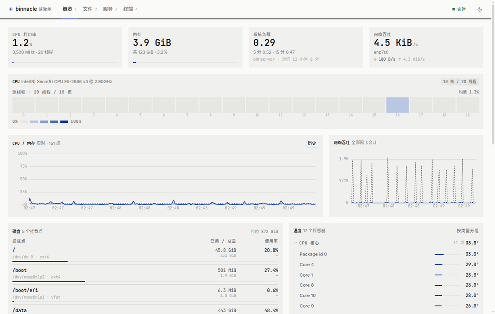
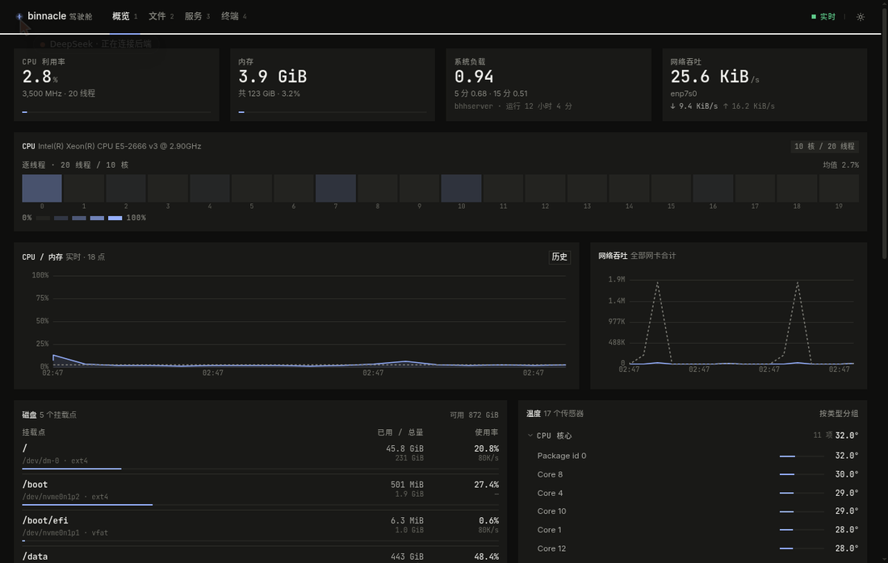

# binnacle

服务器状态监控 + 完整文件系统 + 服务管理 + Web 终端。单 Go 二进制，无外部依赖（除 NVML 动态库）。

<p align="center">
  
</p>

<p align="center">
  
</p>

**这不是 DSH 的组件**，是独立的运维面板，端口独立（默认 8090）。

---

## 一、为什么是自建

选型阶段对比过 Cockpit、1Panel、Netdata、Grafana、Beszel、dashdot、glances、filebrowser、copyparty 等，
最终选择自建 + 借鉴现成项目代码，原因：

1. 本机是 **RTX 3060（消费卡）+ Tesla V100-SXM2（转接成 PCIe + 水冷）** 的混合配置，
   两张卡可用字段完全不同，任何现成面板都会在字段适配上卡住，要么显示假的 0，要么留一堆 N/A。
2. 前端有独立的 agent 负责，后端只需要输出干净的 API 契约，不必迁就别人的 UI 结构。
3. 单二进制、systemd 一个单元、零运行时依赖，符合「别把机器搞脏」的要求。

### 借鉴来源（全部 MIT / Apache-2.0 / BSD，无 AGPL 污染）

| 项目 | ★ | 借鉴点 |
|---|---|---|
| [NVIDIA/go-nvml](https://github.com/NVIDIA/go-nvml) | 464 | NVML 官方 Go 绑定，直接依赖 |
| [utkuozdemir/nvidia_gpu_exporter](https://github.com/utkuozdemir/nvidia_gpu_exporter) | 1581 | GPU 指标模型与命名 |
| [XuehaiPan/nvitop](https://github.com/XuehaiPan/nvitop) | 7240 | 进程级显存归因（pid → comm / owner） |
| [niklasfrick/spark-dashboard](https://github.com/niklasfrick/spark-dashboard) | 142 | 整体架构（NVML + procfs 采集 → WS 推送）、面板可编排思路 |
| [SikamikanikoBG/homelab-monitor](https://github.com/SikamikanikoBG/homelab-monitor) | 231 | throttle 位掩码解码表、磁盘 treemap 思路 |
| [filebrowser/filebrowser](https://github.com/filebrowser/filebrowser) | 35869 | 文件管理 REST 语义 |
| [9001/copyparty](https://github.com/9001/copyparty) | 47265 | 分块断点续传设计 |
| [tsl0922/ttyd](https://github.com/tsl0922/ttyd) / [sorenisanerd/gotty](https://github.com/sorenisanerd/gotty) | 12588 / 2569 | PTY over WebSocket 转发 |
| [henrygd/beszel](https://github.com/henrygd/beszel) | 26879 | SQLite 环形缓冲存储设计 |
| [amir20/dozzle](https://github.com/amir20/dozzle) | 14812 | 日志流式推送 |

---

## 二、本机实测能力矩阵

采集字段全部经过实测验证（`nvidia-smi` + Go/NVML 双路交叉确认）：

| 字段 | RTX 3060 12G | Tesla V100-SXM2-16G |
|---|---|---|
| GPU / 显存利用率 | ✅ | ✅ |
| 显存总量/已用 | ✅ 12288 MiB | ✅ 16384 MiB |
| GPU 温度 | ✅ | ✅ |
| **显存温度** | ❌ 不支持 | ✅ |
| 功耗 / 功耗墙 | ✅ 19/170 W | ✅ 23/300 W |
| SM / 显存时钟 | ✅ | ✅ |
| **风扇转速** | ✅ 支持（低温 0%，正常） | ❌ **不支持**（SXM2 被动散热） |
| **ECC** | ❌ 不支持 | ✅ Enabled，0 错误 |
| PCIe 链路 | ⚠️ 空闲降速 gen1 x8 | ✅ gen3 x16 满速 |
| Throttle reasons | ✅ | ✅ |
| 进程级显存占用 | ✅ | ✅ |
| P-State | ✅ | ✅ |

### 硬件侧的关键事实（写代码时踩过的坑）

1. **V100 是水冷**：待机 24°C（GPU）/ 23°C（显存），功耗 23 W。风冷 SXM2 待机通常 35-42°C。
   `lsusb` 中**没有独立水冷控制器**，所以水温、水泵转速拿不到。
   主板 `nct6779` 只有 `fan2 = 1157 RPM` 一个通道有读数，无法确认对应哪个风扇。
   如果以后水冷控制器接了 USB 控制线（NZXT Kraken / 海盗船 Commander 之类），加一个 `liquidctl` 采集器即可。

2. **V100 通过转接板接成 PCIe**：`lspci` 显示 `LnkCap: 8GT/s x16`、`LnkSta: 8GT/s x16`，
   即 **PCIe 3.0 x16 满速**，转接板没有造成链路损失。

3. **3060 的 PCIe 降速是省电不是故障**：空闲时 `gen1 x8`，`genMax` 是 3（驱动报告值），
   实际硬件支持 Gen4 x16。负载上来会自己恢复。**前端不要对此报警。**

4. **主板传感器脏数据**：`nct6779` 的 `AUXTIN1/2/3` 读 112/112/114°C，是未接热敏电阻的悬空通道，
   已在 `collect/host.go:isDanglingTemp()` 中过滤。同理 `Vcore 1.83V ALARM`、`in6/in9/in10-in14 ALARM`
   都是 X99 已知误报，代码不采集电压。

5. **磁盘不止一个分区**：`/`、`/boot`、`/boot/efi`、`/data`、`/data2`。`/data` 已用 48.4%。

6. **CPU 拓扑**：E5-2666 v3，10 物理核 / 20 线程。`coretemp` 报 11 个传感器（Package + 10 核）。
   `gopsutil` 的 `cpu.Info().Cores` 在 Linux 上会算错，改用 sysfs `topology/{core_id,physical_package_id}` 去重。

---

## 三、目录结构

```
binnacle/
├── API.md                  # 给前端的接口契约（重要，先读这个）
├── collect/
│   ├── types.go            # 数据模型，JSON 字段即 API 契约
│   ├── gpu.go              # NVML 直连采集（cgo）
│   ├── host.go             # CPU/内存/磁盘/网络/传感器
│   └── uid.go              # uid → username
├── api/
│   ├── server.go           # 路由、鉴权、静态托管
│   ├── hub.go              # WebSocket 广播
│   ├── store.go            # SQLite 历史存储
│   ├── fs.go               # 文件系统 CRUD
│   ├── fs_extra.go         # 上传、缩略图、zip
│   ├── services.go         # systemd 管理 + 日志
│   ├── term.go             # PTY 终端
│   └── util.go
└── cmd/
    ├── binnacle/main.go  # 主程序
    └── probe/main.go       # 采集调试工具（打印一份 JSON 快照）
```

---

## 四、构建

```bash
# 依赖：Go 1.26+、gcc、libnvidia-ml（驱动自带）
cd ~/binnacle

# cgo 会因 NVML 头文件的 deprecated 标注刷大量警告，用 -w 压掉
CGO_CFLAGS="-w" go build -o binnacle ./cmd/binnacle

# 调试：打印一份采集快照
CGO_CFLAGS="-w" go run ./cmd/probe
```

产物：**19 MB 单二进制**。

### 前端（web-src/）

```bash
cd web-src
pnpm install
pnpm build          # 默认输出到仓库根 web/
```

输出目录可用环境变量覆盖：

```bash
BINNACLE_WEB_OUT=/opt/binnacle/web pnpm build
```

技术栈：React 19 + Vite 6 + Tailwind 4 + TypeScript（strict）。
图表用 uPlot（10 KB 级高频刷新），终端用 xterm.js，大目录虚拟滚动用 @tanstack/react-virtual。
构建产物按 xterm / charts / vendor 拆包，首屏主包 gzip 约 104 KB。

---

## 五、运行

```bash
# 仅本机访问（默认，最安全）
./binnacle -addr 127.0.0.1:8090 -root / -state /var/lib/binnacle -web /opt/binnacle/web

# 局域网访问：绑定内网 IP，配合防火墙限源网段
./binnacle -addr 192.168.1.66:8090 -root / -state /var/lib/binnacle -web /opt/binnacle/web
ufw allow from 192.168.1.0/24 to any port 8090 proto tcp
```

| 参数 | 默认 | 说明 |
|---|---|---|
| `-addr` | `127.0.0.1:8090` | 监听地址。**默认只绑本地**，生产走 SSH 隧道 |
| `-root` | `/` | 文件管理根目录，可限定到某个子树 |
| `-state` | `/var/lib/binnacle` | token 与 SQLite 存放处 |
| `-web` | 自动探测 | 前端静态目录，找不到时只提供 API |
| `-sample` | `1000` | 采样间隔（毫秒） |
| `-retain` | `7` | 历史保留天数 |
| `-token` | 自动生成 | 固定 token；不填则首次启动生成并写入 `<state>/token`（0600） |

启动日志会打印 token，首次登录用 `POST /api/login`。

### systemd 单元

```ini
[Unit]
Description=binnacle (server monitor + file manager)
After=network-online.target
Wants=network-online.target

[Service]
Type=simple
User=root
WorkingDirectory=/opt/binnacle
ExecStart=/opt/binnacle/binnacle -addr 127.0.0.1:8090 -root / -state /var/lib/binnacle -web /opt/binnacle/web
Restart=always
RestartSec=3

NoNewPrivileges=yes
PrivateTmp=yes

[Install]
WantedBy=multi-user.target
```

注意：`NoNewPrivileges` 不影响 NVML；但如果以后加了 `ProtectSystem=strict`，
要额外放行 `/sys/class/hwmon` 的读权限。

---

## 六、已实测通过的接口

启动在 127.0.0.1:8091（root 限定 `/srv`）跑过一轮完整验证：

| 项 | 结果 |
|---|---|
| `/api/health` | ✅ |
| `POST /api/login` + Cookie | ✅ |
| 未授权访问 `/api/snapshot` | ✅ 返回 401 |
| `GET /api/snapshot`（含 2 张 GPU） | ✅ |
| `WS /ws` 实时推送 | ✅ 1 秒一帧，CPU/内存/GPU 齐全 |
| `GET /api/fs/list` | ✅ 排序、隐藏文件、软链识别 |
| 路径穿越 `../../etc/shadow` | ✅ 拒绝 |
| URL 编码穿越 `%2e%2e%2f` | ✅ 拒绝 |
| 绝对路径越界 `/etc/passwd`（root 受限时） | ✅ 拒绝 |
| `GET /api/fs/read` | ✅ |
| 整文件上传 3 MB | ✅ |
| 分块续传 3×1 MB | ✅ md5 与源文件一致 |
| `GET /api/fs/thumb` | ✅ 输出 JPEG |
| `GET /api/services` | ✅ 7 个白名单 unit，含 PID 与启动时间 |
| `WS /ws/logs/{unit}` | ✅ 3 秒收到 174 行 |
| `WS /ws/term` | ✅ 执行命令、`nvidia-smi` 均正常回显 |
| 采样耗时 | ✅ **200 ms**（两张卡 + 全主机） |

---

## 七、安全设计

1. **默认绑 127.0.0.1**，不裸奔公网。推荐 `ssh -L 8090:127.0.0.1:8090 root@<host>`。
2. **Token 鉴权**：`X-Token` 头 / `?token=` / HttpOnly Cookie 三选一，常量时间比较。
3. **路径穿越防护**：`filepath.Clean` + 前缀校验，URL 编码先解码再判断，已测 `..`、`%2e%2e%2f`、绝对路径越界三种。
4. **systemd unit 白名单**：只有 `dsh-*`、`binnacle*`、`jupyter*`、`docker`、`containerd`、`sshd`、`mihomo`、`cockpit*` 可操作。
5. **`dsh-console` 的 8080 目前绑 0.0.0.0 裸奔**，这个洞与本次无关，但建议一并收掉。

---

## 八、待办（前端交接后）

- [ ] 前端由 frontend-engineer agent 实现，按 `API.md` 对接
- [ ] 前端完成后补 `-web` 目录与 systemd 部署
- [ ] 可选：水冷控制器接入后加 `liquidctl` 采集器
- [ ] 可选：DCGM 集成（ECC / XID / NVLink 更细粒度）
- [ ] 可选：告警（温度墙、ECC 增长、磁盘满）
